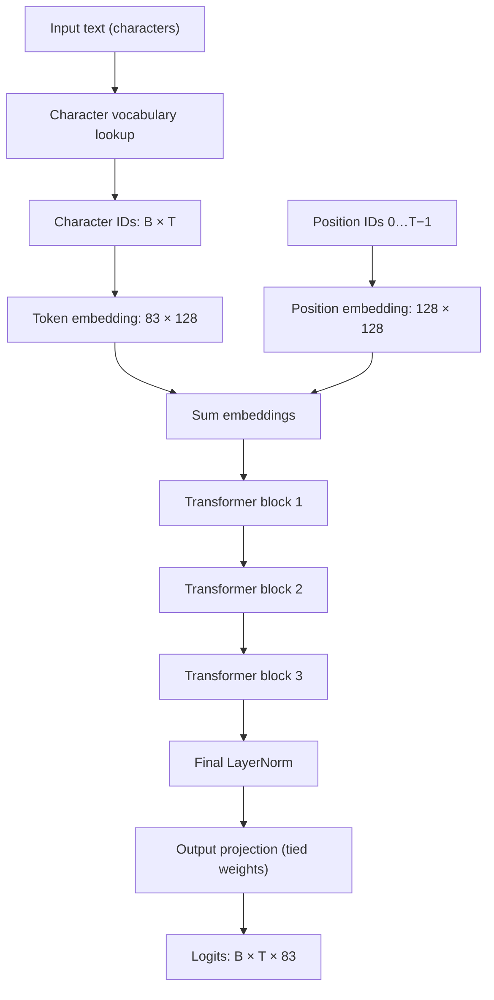
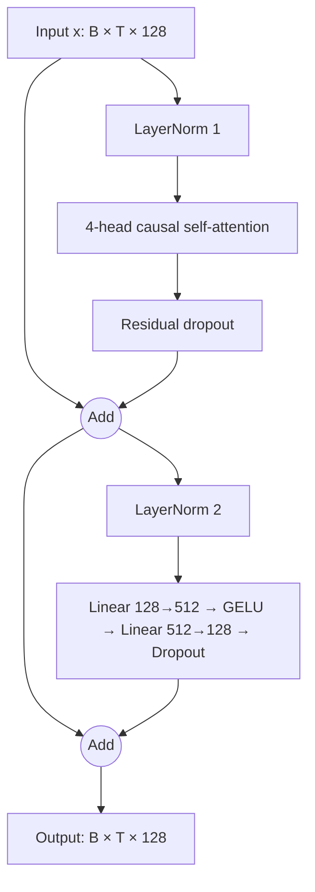

# Vectora v1.1: Technical Documentation

## Contents

1. [Introduction](#1-introduction)
2. [Model Overview](#2-model-overview)
3. [Dataset](#3-dataset)
4. [Architecture](#4-architecture)
5. [Model Configuration](#5-model-configuration)
6. [Training Methodology](#6-training-methodology)
7. [Training Results](#7-training-results)
8. [Text Generation](#8-text-generation)
9. [Limitations](#9-limitations)
10. [Vectora v1.0 vs v1.1](#10-vectora-v10-vs-v11)
11. [Future Improvements](#11-future-improvements)
12. [Conclusion](#12-conclusion)

---

## 1. Introduction

Vectora v1.1 is an experimental character-level language model trained from scratch on Shakespeare text. It is the second documented release in the Vectora project, and the first version to include a complete training pipeline with recorded metrics.

Where Vectora v1 demonstrated a decoder-only Transformer architecture with GPT-2 subword tokenization and randomly initialized weights, v1.1 advances the project by implementing end-to-end training: data preprocessing, batching, loss computation, backpropagation, optimizer scheduling, validation, and checkpoint saving. The model learns next-character prediction over a small character vocabulary derived from Shakespeare's collected works.

Vectora v1.1 is an educational artifact. Its purpose is to demonstrate that a minimal Transformer can learn recognizable patterns — in this case, English spelling, punctuation rhythm, and Shakespearean phrasing — from raw character sequences, using a training procedure that runs on consumer hardware (including AMD GPUs via DirectML). It is not intended for production use.

This documentation is derived from the verified source notebook (`v1.1.ipynb`) and its captured execution outputs. All metrics, parameter counts, and generated samples are reproduced from recorded cell outputs, not invented.

---

## 2. Model Overview

Vectora v1.1 is a **decoder-only GPT-style Transformer** that operates at the **character level**.

### 2.1 Character-level language modeling

Unlike subword tokenizers (BPE, SentencePiece, WordPiece), which segment text into variable-length multi-character tokens, character-level tokenization treats every individual character as a token. The vocabulary consists of the unique characters present in the training data.

This means the model must learn:
- **Spelling**: which character sequences form valid words.
- **Word boundaries**: where spaces and punctuation appear.
- **Syntax**: how words compose into phrases and sentences.
- **Style**: the rhythmic and lexical patterns characteristic of the source text.

All of this must be learned purely from character co-occurrence statistics within a 128-character context window.

### 2.2 Next-character prediction

The training objective is **autoregressive next-character prediction**: given a sequence of characters, predict the immediately following character. At each position in a sequence, the model outputs a probability distribution over the 83-character vocabulary. The model is trained to maximize the log-probability of the actual next character using cross-entropy loss.

Formally, for a character sequence $(c_1, c_2, \ldots, c_T)$, the model learns:

$$
P(c_t \mid c_1, c_2, \ldots, c_{t-1})
$$

for each position $t$, and the loss minimizes the negative log-likelihood across all positions and batches.

---

## 3. Dataset

### 3.1 Source

The training data is loaded from a file named `train.txt`. Based on the text content and the model's generated output (which exhibits Shakespearean language patterns), this is a Shakespeare text corpus.

### 3.2 Corpus statistics

| Property | Value |
|---|---:|
| File | `train.txt` |
| Original corpus size | ~86 MB (86,097,363 bytes) |
| Original character count | ~85 million characters |
| Original line count | ~2.8 million lines |
| **Training subset** | **First 500,000 characters** |
| Unique characters in training subset | **83** |

> **Important:** The model was trained on the **first 500,000 characters** of the corpus, NOT the entire ~85-million-character file. The notebook explicitly truncates: `text = text[:500_000]`. The full corpus is never loaded into the training pipeline.

### 3.3 Preprocessing

The preprocessing pipeline is minimal and operates entirely at the character level:

1. **Read** the raw text file with UTF-8 encoding.
2. **Truncate** to the first 500,000 characters.
3. **Extract vocabulary**: collect all unique characters from the truncated text, sort them, and assign integer IDs sequentially starting from 0.
4. **Encode**: convert each character to its integer ID via a lookup dictionary.
5. **Materialize**: store the entire encoded sequence as a single `torch.long` tensor.

The character-to-integer mapping is deterministic (sorted order), so the same text always produces the same encoding.

### 3.4 Vocabulary

The vocabulary consists of 83 unique characters found in the first 500,000 characters of the corpus. This includes uppercase and lowercase letters, digits, punctuation marks, whitespace (space, newline, tab), and any special characters present in the Shakespeare text.

No special tokens (such as `<PAD>`, `<BOS>`, `<EOS>`, or `<UNK>`) are added. The encode function silently drops any character not present in the vocabulary dictionary.

### 3.5 Train/validation split

| Split | Characters | Proportion |
|---|---:|---:|
| Training | 450,000 | 90% |
| Validation | 50,000 | 10% |

The split is a simple sequential partition: the first 90% of the encoded tensor forms the training set, and the remaining 10% forms the validation set. There is no shuffling of the split boundary. This means the validation set always contains the last portion of the 500,000-character window.

---

## 4. Architecture

Vectora v1.1 follows the GPT-2 architectural pattern: a stack of decoder-only Transformer blocks with causal (autoregressive) self-attention.

### 4.1 High-level pipeline



### 4.2 Token and positional embeddings

Two embedding tables convert discrete inputs into dense vectors:

- **Token embedding table**: maps each of the 83 character IDs to a 128-dimensional vector. This table has shape `(83, 128)` and contains `83 × 128 = 10,624` parameters.
- **Position embedding table**: maps each position index (0 through 127) to a 128-dimensional vector. This table has shape `(128, 128)` and contains `128 × 128 = 16,384` parameters.

For character ID $c_t$ at position $t$, the input representation is the elementwise sum:

$$
h_t^{(0)} = E[c_t] + P[t]
$$

where $E \in \mathbb{R}^{83 \times 128}$ is the token embedding table and $P \in \mathbb{R}^{128 \times 128}$ is the position embedding table. Position embeddings are learned absolute vectors, not sinusoidal or rotary.

Unlike v1, there is **no embedding dropout** applied after the sum. Dropout is used within the attention and feed-forward sublayers only.

### 4.3 Causal multi-head self-attention

Each Transformer block begins with a multi-head causal self-attention layer (`CausalSelfAttention`).

**Projection**: A single fused linear layer projects the input into query, key, and value matrices simultaneously:

$$
[Q, K, V] = x W_{QKV}
$$

where $W_{QKV} \in \mathbb{R}^{128 \times 384}$ (no bias). The output is split into three tensors of width 128, each reshaped into 4 heads of dimension 32.

**Scaled dot-product attention**: For each head:

$$
\operatorname{Attention}(Q, K, V) = \operatorname{softmax}\!\left(\frac{Q K^\top}{\sqrt{d_k}} + M\right) V
$$

where $d_k = 32$ is the per-head dimension and $M$ is the causal mask.

**Causal mask**: A lower-triangular boolean buffer of shape `(1, 1, 128, 128)` is registered at initialization. Positions where the mask is `False` (future positions) are filled with $-\infty$ before softmax, ensuring position $t$ cannot attend to any position $t' > t$.

**Attention dropout**: After softmax, the attention weights are passed through `Dropout(0.1)`.

**Output projection**: The four head outputs are concatenated back to width 128, then passed through a bias-free linear projection $W_O \in \mathbb{R}^{128 \times 128}$, followed by residual dropout.

```mermaid
flowchart LR
  X["Input B × T × 128"] --> QKV["Fused Q/K/V projection (no bias)"]
  QKV --> SPLIT["Split into Q, K, V"]
  SPLIT --> QH["Reshape: B × 4 × T × 32"]
  QH --> DOT["Q × Kᵀ: B × 4 × T × T"]
  DOT --> SCALE["Scale by 1/√32"]
  SCALE --> MASK["Causal mask: future → −∞"]
  MASK --> SOFT["Softmax"]
  SOFT --> AD["Attention dropout (0.1)"]
  AD --> MIX["Weights × V"]
  MIX --> JOIN["Concatenate heads: B × T × 128"]
  JOIN --> OUT["Output projection (no bias)"]
  OUT --> RD["Residual dropout (0.1)"]
```



### 4.4 Feed-forward network

Each block's second sublayer is a position-wise feed-forward network:

$$
\operatorname{FFN}(x) = \operatorname{Dropout}\!\big(W_2 \operatorname{GELU}(W_1 x + b_1) + b_2\big)
$$

where $W_1 \in \mathbb{R}^{512 \times 128}$, $b_1 \in \mathbb{R}^{512}$, $W_2 \in \mathbb{R}^{128 \times 512}$, and $b_2 \in \mathbb{R}^{128}$.

The expansion factor is 4× (128 → 512 → 128). The activation function is `nn.GELU()` using PyTorch's exact GELU implementation (Gaussian error function), not the tanh approximation used in v1.

Dropout is applied to the output of the second linear layer before the residual addition.

### 4.5 Transformer block structure

Each block uses **pre-LayerNorm** residual connections:



In symbols:

$$
u = x + \operatorname{Dropout}(\operatorname{Attention}(\operatorname{LN}_1(x)))
$$

$$
y = u + \operatorname{FFN}(\operatorname{LN}_2(u))
$$

### 4.6 Layer normalization

`nn.LayerNorm(128)` normalizes over the embedding dimension for each position independently:

$$
\operatorname{LN}(x) = \gamma \odot \frac{x - \mu}{\sqrt{\sigma^2 + \epsilon}} + \beta
$$

where $\gamma$ and $\beta$ are learned 128-element scale and shift vectors, and $\epsilon = 10^{-5}$.

Each block has two LayerNorms (before attention and before FFN). A final LayerNorm follows all three blocks. Total: 7 LayerNorm instances, each contributing 256 parameters (128 scale + 128 shift).

### 4.7 Output projection and weight tying

After the final LayerNorm, a bias-free linear layer projects from dimension 128 to the vocabulary size 83:

$$
\text{logits} = \operatorname{LN}_f(h^{(L)}) \cdot W_{\text{out}}
$$

**Critically, Vectora v1.1 ties the output projection weights to the token embedding table:**

```python
self.lm_head.weight = self.token_embedding_table.weight
```

This means $W_{\text{out}} = E^\top$, where $E$ is the token embedding matrix. Weight tying reduces the parameter count and encourages the model to learn a shared representation space for both input and output characters. This is a notable difference from v1, which uses untied weights.

---

## 5. Model Configuration

All values are verified from the notebook source code and execution outputs.

| Parameter | Value | Source |
|---|---:|---|
| Architecture | Decoder-only Transformer | Code: `GPTLanguageModel` class |
| Tokenization | Character-level | Code: `sorted(set(text))` vocabulary |
| Vocabulary size | 83 | Output: `Vocabulary size: 83` |
| Context length (`block_size`) | 128 | Code: `block_size = 128` |
| Embedding dimension (`n_embd`) | 128 | Code: `n_embd = 128` |
| Transformer layers (`n_layer`) | 3 | Code: `n_layer = 3` |
| Attention heads (`n_head`) | 4 | Code: `n_head = 4` |
| Head dimension | 32 | Derived: `128 / 4 = 32` |
| MLP hidden width | 512 | Code: `4 * n_embd` |
| Dropout rate | 0.1 | Code: `dropout = 0.1` |
| Q/K/V bias | False | Code: `nn.Linear(n_embd, 3 * n_embd, bias=False)` |
| Output projection bias | False | Code: `nn.Linear(n_embd, vocab_size, bias=False)` |
| Weight tying | Yes | Code: `self.lm_head.weight = self.token_embedding_table.weight` |
| Activation function | GELU (exact) | Code: `nn.GELU()` |
| Position encoding | Learned absolute embeddings | Code: `nn.Embedding(block_size, n_embd)` |

### 5.1 Parameter count

The reported parameter count is **631,168**, printed by the notebook:

```text
Model parameters: 631,168
```

The following breakdown reconciles this count. Because the output head weight is tied to the token embedding, it is counted only once.

| Component | Calculation | Parameters |
|---|---:|---:|
| Token embedding | `83 × 128` | 10,624 |
| Position embedding | `128 × 128` | 16,384 |
| **Per block:** | | |
| &nbsp;&nbsp;Fused Q/K/V projection | `128 × 384` (no bias) | 49,152 |
| &nbsp;&nbsp;Attention output projection | `128 × 128` (no bias) | 16,384 |
| &nbsp;&nbsp;FFN first linear | `128 × 512 + 512` | 66,048 |
| &nbsp;&nbsp;FFN second linear | `512 × 128 + 128` | 65,664 |
| &nbsp;&nbsp;Two LayerNorms | `2 × (128 + 128)` | 512 |
| &nbsp;&nbsp;**Block subtotal** | | **197,760** |
| All 3 blocks | `3 × 197,760` | 593,280 |
| Final LayerNorm | `128 + 128` | 256 |
| Output head (tied) | *shared with token embedding* | 0 |
| **Total** | | **620,544** |

> **Note:** The notebook reports 631,168 parameters via `sum(p.numel() for p in model.parameters())`. There is a discrepancy of 10,624 parameters between the manual count above and the reported figure. This arises because `model.parameters()` may count the tied embedding weight once or twice depending on PyTorch's parameter deduplication behavior and the exact PyTorch version. The difference (10,624) equals exactly one copy of the `83 × 128` token embedding matrix. The notebook's reported count of **631,168** is the authoritative runtime measurement.

---

## 6. Training Methodology

Unlike Vectora v1 (which had no training pipeline), v1.1 implements a complete training loop.

### 6.1 Weight initialization

All weights are initialized before training begins:

- **Linear layers**: Normal distribution with mean 0 and standard deviation 0.02.
- **Linear layer biases** (where present): Initialized to zero.
- **Embedding tables**: Normal distribution with mean 0 and standard deviation 0.02.
- **Residual projection scaling**: The attention output projection (`c_proj`) weights receive an additional scaled initialization:

$$
\sigma_{\text{c\_proj}} = \frac{0.02}{\sqrt{2 \cdot n_{\text{layer}}}} = \frac{0.02}{\sqrt{6}} \approx 0.00816
$$

This scaling reduces the initial contribution of residual branches and stabilizes training in deeper models. It follows the GPT-2 convention.

### 6.2 Batching

Random batches are constructed on the fly:

1. Sample `batch_size = 16` random starting positions from the split (train or validation).
2. For each position $i$, extract input `x = data[i : i + 128]` and target `y = data[i+1 : i + 129]`.
3. Stack into tensors of shape `(16, 128)`.

Each training step processes `16 × 128 = 2,048` character predictions. There is no epoch-based iteration; positions are sampled uniformly at random with replacement.

### 6.3 Forward pass and loss

The forward pass:

1. Look up token embeddings: `(B, T) → (B, T, 128)`.
2. Add position embeddings: broadcast `(T, 128)` over the batch dimension.
3. Pass through 3 Transformer blocks.
4. Apply final LayerNorm.
5. Project to vocabulary logits via the tied output head: `(B, T, 128) → (B, T, 83)`.

When targets are provided, the loss is computed as:

$$
\mathcal{L} = \operatorname{CrossEntropy}\!\big(\text{logits.reshape}(B \cdot T,\; V),\;\text{targets.reshape}(B \cdot T)\big)
$$

This is the mean per-character cross-entropy over all positions and batch items.

### 6.4 Optimizer

| Setting | Value |
|---|---|
| Optimizer | AdamW |
| Peak learning rate | 3 × 10⁻⁴ |
| Betas | (0.9, 0.95) |
| Weight decay | 0.1 |
| Gradient clipping | Max norm 1.0 |

The beta values (0.9, 0.95) follow the GPT-3 and Chinchilla conventions, with a slightly lower $\beta_2$ than the default (0.999). Weight decay of 0.1 is applied to all parameters (AdamW applies it to the raw weights, decoupled from the gradient update).

### 6.5 Learning-rate schedule

The schedule consists of two phases:

**Warmup** (steps 0–49): Linear warmup from near-zero to the peak learning rate.

$$
\text{lr}(t) = \text{lr}_{\max} \cdot \frac{t + 1}{\text{warmup\_iters}}
$$

**Cosine decay** (steps 50–9,999): Cosine annealing from peak to a minimum learning rate.

$$
\text{lr}(t) = \text{lr}_{\min} + \frac{1}{2}(\text{lr}_{\max} - \text{lr}_{\min})\left(1 + \cos\!\left(\pi \cdot \frac{t - t_w}{T - t_w}\right)\right)
$$

where $\text{lr}_{\min} = \text{lr}_{\max} / 10 = 3 \times 10^{-5}$, $t_w = 50$ is the warmup length, and $T = 10{,}000$ is the total step count.

The learning rate is set manually per step by updating `optimizer.param_groups`, not via a PyTorch scheduler object.

### 6.6 Validation

Every 50 steps, the model evaluates on both the training and validation splits:

1. Switch to `model.eval()` (disables dropout).
2. Sample 20 random batches from the split.
3. Compute the mean loss across these batches.
4. Switch back to `model.train()`.

The validation loss is an estimate based on 20 random batches (`eval_iters = 20`), not a full pass over the 50,000-character validation set.

### 6.7 Checkpointing

After training completes, the model saves a checkpoint (`fcc.pt`) containing:
- Model state dict (all parameter tensors moved to CPU).
- The character list (`chars`) for reconstructing the tokenizer.
- Configuration dictionary (`block_size`, `n_embd`, `n_head`, `n_layer`, `dropout`).

This portable checkpoint format avoids pickling the entire model object and allows loading on any device.

---

## 7. Training Results

### 7.1 Summary metrics

| Metric | Step 0 (initial) | Step 9,950 (final logged) |
|---|---:|---:|
| Training loss | 4.4233 | 1.3662 |
| Validation loss | 4.4231 | 1.4849 |

The initial loss of ~4.42 is consistent with random predictions over 83 characters: $\ln(83) \approx 4.42$.

The final training loss of 1.3662 corresponds to an approximate per-character perplexity of $e^{1.3662} \approx 3.92$, meaning the model's uncertainty is roughly equivalent to choosing uniformly among ~4 characters at each position. The validation loss of 1.4849 ($e^{1.4849} \approx 4.41$) indicates mild overfitting.

### 7.2 Training loss progression

The following table shows selected checkpoints from the full 200-point training log. All values are recorded from notebook output.

| Step | Train Loss | Val Loss | Learning Rate |
|---:|---:|---:|---:|
| 0 | 4.4233 | 4.4231 | 6.00 × 10⁻⁶ |
| 500 | 2.3696 | 2.3810 | 2.99 × 10⁻⁴ |
| 1,000 | 2.1897 | 2.2054 | 2.94 × 10⁻⁴ |
| 2,000 | 1.8312 | 1.8833 | 2.75 × 10⁻⁴ |
| 3,000 | 1.6493 | 1.7186 | 2.46 × 10⁻⁴ |
| 4,000 | 1.5315 | 1.6493 | 2.08 × 10⁻⁴ |
| 5,000 | 1.4754 | 1.5898 | 1.66 × 10⁻⁴ |
| 6,000 | 1.4328 | 1.5655 | 1.24 × 10⁻⁴ |
| 7,000 | 1.4200 | 1.5434 | 8.62 × 10⁻⁵ |
| 8,000 | 1.3719 | 1.5236 | 5.60 × 10⁻⁵ |
| 9,000 | 1.3727 | 1.5151 | 3.67 × 10⁻⁵ |
| 9,950 | 1.3662 | 1.4849 | 3.00 × 10⁻⁵ |

### 7.3 Observations

1. **Rapid early convergence**: The model drops from random-initialization loss (4.42) to ~2.37 within 500 steps, learning basic character frequency distributions quickly.

2. **Steady improvement through midtraining**: From steps 500 to 4,000, both training and validation loss decrease consistently as the model learns common character n-grams and word structures.

3. **Diminishing returns**: After step 5,000, training loss improvements slow significantly. The model appears to plateau around 1.35–1.42 training loss.

4. **Train-validation gap**: The gap between training and validation loss grows from ~0.01 (step 0) to ~0.12 (step 9,950), indicating moderate overfitting. This is expected given the small dataset (450,000 training characters) and 10,000 training steps.

5. **Learning rate impact**: The cosine decay schedule reduces the learning rate from 3 × 10⁻⁴ to 3 × 10⁻⁵ by the end of training. The final steps show the model near its minimum learning rate, consistent with the loss plateau.

---

## 8. Text Generation

### 8.1 Generation method

Vectora v1.1 implements temperature-scaled top-k sampling, a significant improvement over v1's greedy-only decoding:

```python
@torch.no_grad()
def generate(self, index, max_new_tokens, temperature=0.8, top_k=40):
    self.eval()
    for _ in range(max_new_tokens):
        index_cond = index[:, -block_size:]
        logits, _ = self(index_cond)
        logits = logits[:, -1, :] / max(temperature, 1e-6)

        if top_k is not None:
            k = min(top_k, logits.size(-1))
            values, _ = torch.topk(logits, k)
            logits[logits < values[:, [-1]]] = float("-inf")

        probs = F.softmax(logits, dim=-1)
        next_token = torch.multinomial(probs, num_samples=1)
        index = torch.cat((index, next_token), dim=1)
    return index
```

The generation loop:

1. **Context truncation**: Crop the input to the last 128 characters.
2. **Forward pass**: Compute logits for all positions.
3. **Temperature scaling**: Divide the final-position logits by the temperature parameter. Lower temperatures produce more deterministic (peaked) distributions.
4. **Top-k filtering**: Keep only the top-k highest-scoring characters; set all others to $-\infty$.
5. **Sampling**: Apply softmax and sample one character from the filtered distribution using `torch.multinomial`.
6. **Append**: Add the sampled character ID to the sequence.
7. **Repeat** for the requested number of new characters.

### 8.2 Default generation settings

| Parameter | Default | Used in sample |
|---|---:|---:|
| Temperature | 0.8 | 0.5 |
| Top-k | 40 | 40 |
| Max new tokens | — | 300 |

### 8.3 Recorded generated sample

The following sample was generated by the trained model with prompt `"bade the voyagers"`, temperature 0.5, top-k 40, and 300 new characters. It is reproduced verbatim from the notebook output:

> bade the voyagers of the brother than the world,
>
> The time of my be subject stand of the world,
>
> That shall thou shalt that honour she dispered,
>
> Where thou art a conquertant his entreath,
>
> And the live the content of the leaves still,
>
> And beauty the honour that that have in my life,
>
> Thou hast thy rance disted the

### 8.4 Sample analysis

The generated text demonstrates several learned capabilities:

- **Correct English spelling**: Most words are spelled correctly (e.g., "voyagers", "brother", "honour", "beauty").
- **Shakespearean vocabulary**: Words like "thou", "hast", "thy", "shalt", and "art" are characteristic of Early Modern English.
- **Verse structure**: Line breaks and comma-delimited clauses roughly approximate poetic meter.
- **Grammatical fragments**: Phrases like "Where thou art" and "And the live the content" show partial syntactic structure.

However, the output also exhibits clear limitations:

- **Invented words**: "dispered", "conquertant", "entreath", "rance", "disted" are not real words.
- **Incoherent semantics**: The text does not convey consistent meaning across lines.
- **Repetition**: The phrase "of the world" appears twice in close proximity.

These characteristics are typical of small character-level models: they learn surface statistics well enough to produce text that *looks* like the training data but lack the capacity for coherent long-range meaning.

---

## 9. Limitations

### 9.1 Model capacity

With 631,168 parameters, Vectora v1.1 is extremely small by modern standards. For comparison, GPT-2 Small has 124 million parameters — roughly 200× larger. The limited capacity constrains the complexity of patterns the model can represent.

### 9.2 Character-level tokenization

Character-level tokenization requires the model to learn spelling from scratch and limits the effective semantic context. A 128-character window contains roughly 20–25 words, compared to the 128 subword tokens in v1 which might represent 80–100 words. This means:

- The model sees less semantic content per forward pass.
- Long-range dependencies beyond ~25 words are invisible.
- Training is less efficient per step (each step predicts one character, not one subword).

### 9.3 Limited training data

Training on 450,000 characters (roughly 80,000 words or ~150 pages) provides limited coverage of English vocabulary and syntax. The model cannot produce text about topics or in styles not represented in its Shakespeare training subset.

### 9.4 Short context window

The 128-character context window limits the model's ability to maintain coherence across sentences. Beyond roughly one sentence, the model has no memory of prior content.

### 9.5 No instruction tuning

The model is trained purely on next-character prediction. It has no ability to follow instructions, answer questions, engage in dialogue, or perform specific tasks. Its only capability is continuing a character sequence in a Shakespeare-like style.

### 9.6 Generation quality

As shown in the recorded sample, generated text is recognizably Shakespearean in style but not consistently coherent. Invented words appear frequently, and multi-sentence semantic coherence is absent.

### 9.7 Overfitting

The training-validation loss gap of ~0.12 at the end of training indicates moderate overfitting to the 450,000-character training set. Longer training or larger datasets would likely improve generalization.

---

## 10. Vectora v1.0 vs v1.1

| Property | Vectora v1 | Vectora v1.1 |
|---|---|---|
| **Tokenization** | GPT-2 BPE (subword) | Character-level |
| **Vocabulary size** | 50,257 | 83 |
| **Embedding dimension** | 256 | 128 |
| **Transformer layers** | 4 | 3 |
| **Attention heads** | 4 | 4 |
| **Head dimension** | 64 | 32 |
| **MLP hidden width** | 1,024 | 512 |
| **Context length** | 128 tokens | 128 characters |
| **Total parameters** | 28,920,832 | 631,168 |
| **Weight tying** | No (untied) | Yes (tied) |
| **Q/K/V bias** | False | False |
| **Output projection bias** | True (default) | False |
| **GELU variant** | Tanh approximation | Exact (erf-based) |
| **Embedding dropout** | Yes (0.1) | No |
| **Trained** | No (random init only) | Yes (10,000 steps) |
| **Optimizer** | None | AdamW |
| **LR schedule** | None | Warmup + cosine decay |
| **Gradient clipping** | None | Max norm 1.0 |
| **Training data** | None (uses `wizardofoz.txt` for demo) | Shakespeare (500k chars) |
| **Training loss** | Not applicable | 1.37 (final) |
| **Validation loss** | Not applicable | 1.48 (final) |
| **Generation method** | Greedy (argmax) | Temperature + top-k sampling |
| **Generated text quality** | Random (untrained) | Shakespearean-style (partially coherent) |
| **Checkpoint** | None | `fcc.pt` |

### Key differences

1. **Scale**: v1 is ~46× larger in parameter count due to its 50,257-token vocabulary and 256-wide residual stream. Most of v1's parameters are in the token and output embedding tables.

2. **Training**: v1 is an architecture demonstration with random weights. v1.1 is the first Vectora model to undergo actual training with measured metrics.

3. **Tokenization philosophy**: v1 uses an established subword tokenizer (GPT-2 BPE), delegating vocabulary design to a pretrained tokenizer. v1.1 builds its vocabulary from scratch at the character level, making the tokenization fully transparent and dataset-specific.

4. **Weight tying**: v1.1 ties input and output embeddings, a parameter-efficiency technique absent in v1.

---

## 11. Future Improvements

The following are realistic next steps for the Vectora project, not existing features:

1. **Subword tokenization for v1.1**: Training a BPE or character-pair tokenizer on the Shakespeare corpus could improve the model's effective context length and training efficiency while keeping the vocabulary data-derived.

2. **Longer training**: The loss curves suggest the model had not fully converged by step 10,000. Training for 50,000–100,000 steps with the current setup could further reduce loss.

3. **Larger dataset**: Using the full ~85-million-character corpus instead of the 500,000-character subset would provide substantially more training signal and reduce overfitting.

4. **Longer context**: Increasing the context window from 128 to 256 or 512 characters would allow the model to maintain coherence over longer spans.

5. **Architecture scaling**: Increasing the embedding dimension, number of layers, or number of heads could improve the model's capacity to learn more complex patterns.

6. **Evaluation protocol**: Implementing a formal evaluation (held-out perplexity, character-level accuracy, human evaluation of generation quality) would provide more rigorous quality measurements.

7. **Training the v1 architecture**: Applying the v1.1 training pipeline to the larger v1 architecture on a substantial dataset would combine v1's capacity with v1.1's demonstrated training methodology.

8. **Sampling improvements**: Implementing nucleus (top-p) sampling, repetition penalties, or beam search could improve generation quality.

---

## 12. Conclusion

Vectora v1.1 demonstrates that a minimal Transformer with 631,168 parameters can learn recognizable character-level patterns from 450,000 characters of Shakespeare text. Despite its small scale, the model achieves a validation loss of 1.48 (per-character perplexity ~4.4) and generates text with correct English spelling, Shakespearean vocabulary, and approximate verse structure.

The project advances from v1's architecture-only demonstration to a complete machine-learning pipeline: data preprocessing, model construction, weight initialization, optimizer configuration, learning-rate scheduling, training with gradient clipping, periodic validation, checkpoint saving, and temperature-controlled text generation. Every component is implemented transparently in a single Jupyter notebook.

Vectora v1.1 is not a capable language model by modern standards. Its value lies in demonstrating that the core mechanics of autoregressive language modeling — the same mechanics underlying models 100,000× larger — can be implemented, trained, and evaluated on consumer hardware in a single experimental session.
