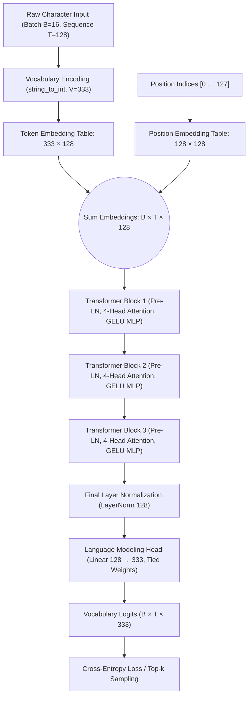

# Vectora v1.2: Technical Documentation

## Contents

1. [Overview](#1-overview)
2. [What's New](#2-whats-new)
3. [Model Architecture](#3-model-architecture)
4. [Dataset](#4-dataset)
5. [Training Configuration](#5-training-configuration)
6. [Training Results](#6-training-results)
7. [Text Generation](#7-text-generation)
8. [Limitations](#8-limitations)
9. [Future Development](#9-future-development)
10. [Reproducibility & Verification](#10-reproducibility--verification)

---

## 1. Overview

**Vectora v1.2** is an experimental GPT-style decoder-only Transformer model trained from scratch on an expanded text corpus of over **82 million characters** (~23.4 million estimated GPT-2 tokens) across **50,000 optimization iterations**. It marks the third milestone in the Vectora research series.

While Vectora v1 established the architectural baseline and tensor data paths, and Vectora v1.1 validated the end-to-end training loop on a 500,000-character subset, **Vectora v1.2 explores pretraining scaling dynamics**. Specifically, the experiment investigates whether a compact 695K-parameter character-level model can maintain training stability, avoid representation collapse, and improve out-of-sample generalization when exposed to a corpus more than **160 times larger** than the v1.1 training slice.

<Callout title="Tokenization & Dataset Scale Clarification" type="important">
The <strong>23,395,305 (approx. 23.4M) token</strong> figure is an estimate generated with the standard GPT-2 subword BPE tokenizer to benchmark the dataset's relative scale against subword language models. The actual Vectora v1.2 model was trained strictly using a <strong>custom character-level tokenizer</strong> over a <strong>333-character vocabulary</strong>.
</Callout>

This documentation records verified parameters, actual execution outputs from the reference notebook (`V1.2-23M.ipynb`), loss dynamics logged at 50-step intervals, sample generations, and observed model limitations.

---

## 2. What's New

Vectora v1.2 introduces several key scaling and configuration adjustments compared to earlier releases:

| Dimension | Vectora v1.0 | Vectora v1.1 | Vectora v1.2 (Current) | Experimental Purpose |
|---|---|---|---|---|
| **Dataset Scale** | Forward pass demo only | 500,000 characters | **82,215,804 characters** | Test scaling behavior across full corpus |
| **GPT-2 Token Estimate** | N/A | ~140k tokens | **~23,395,305 tokens** | Standardized corpus scale benchmark |
| **Vocabulary Size** | 50,257 (tiktoken BPE) | 83 characters | **333 characters** | Support full character diversity without truncation |
| **Training Steps** | 0 (Untrained baseline) | 10,000 steps | **50,000 steps** | 5× longer optimization horizon |
| **Tokens Processed** | 0 | 20.48 million | **102.4 million tokens** | Long-horizon pretraining exposure |
| **Total Parameters** | 28,920,832 | 631,168 | **695,168** | Parameter expansion from larger vocabulary table |
| **Validation Loss** | N/A | 1.4849 | **1.4082** | Improved validation loss despite 164× larger eval split |
| **Output Style** | Random token noise | Poetic verse | **Multi-clause prose & dialogue** | Emergence of broader syntactic patterns |

### Verified Changes in v1.2

1. **Full-Corpus Ingestion**: The training loop ingests the entire `train.txt` file (82,215,804 characters across 2,803,655 lines) without arbitrary sequence truncation.
2. **Expanded Character Set**: By scanning the entire corpus, the unique vocabulary expanded from 83 characters to 333 characters, incorporating extended Unicode punctuation, quote marks, accents, and typographic symbols.
3. **Parameter Increase via Embedding Projection**: Because the embedding matrix has dimensions $V \times d_{\text{model}} = 333 \times 128 = 42,624$, the total parameter count increased from 631,168 to 695,168.
4. **Extended Training Horizon**: Iterations increased from 10,000 to 50,000 steps, executing with continuous cosine decay and gradient clipping.
5. **Generalization Over Massive Validation Set**: The 10% validation split encompasses 8,221,581 characters (versus 50,000 in v1.1). Despite this much larger validation set, the final validation loss dropped from 1.4849 to 1.4082.

---

## 3. Model Architecture

Vectora v1.2 uses a decoder-only Transformer architecture following the GPT-2 design pattern with Pre-LayerNorm residual connections and tied input/output embeddings.

### 3.1 Data Flow Pipeline



### 3.2 Component Specifications

#### Token & Positional Embeddings
Discrete character IDs are mapped to 128-dimensional dense representations:
- **Token Embedding ($W_{\text{token}}$)**: Shape `(333, 128)` with 42,624 parameters.
- **Position Embedding ($W_{\text{pos}}$)**: Shape `(128, 128)` with 16,384 parameters, indexing positions $0 \le t < 128$.

The input hidden states $h_0$ are formed by the unweighted sum:

$$
h_t^{(0)} = W_{\text{token}}[c_t] + W_{\text{pos}}[t], \quad t \in \{0, \dots, T-1\}
$$

No embedding dropout is applied at the embedding layer; dropout is applied exclusively within internal Transformer sublayers.

#### Causal Multi-Head Self-Attention
Each block contains a multi-head causal self-attention module with 4 parallel heads:
- **Embedding Dimension ($d_{\text{model}}$)**: 128
- **Number of Heads ($h$)**: 4
- **Per-Head Dimension ($d_{\text{head}}$)**: $128 / 4 = 32$

Queries, keys, and values are computed simultaneously via a single fused linear projection with `bias=False`:

$$
[Q, K, V] = x W_{QKV}, \quad W_{QKV} \in \mathbb{R}^{128 \times 384}
$$

Attention weights are scaled and masked using a registered lower-triangular causal buffer:

$$
\operatorname{Attention}(Q, K, V) = \operatorname{softmax}\left(\frac{Q K^\top}{\sqrt{32}} + M\right) V
$$

where $M_{i,j} = 0$ for $i \ge j$ and $-\infty$ for $i < j$. Attention dropout of $p = 0.1$ is applied to the normalized attention matrix. A projection matrix $W_O \in \mathbb{R}^{128 \times 128}$ recombines head outputs, followed by residual dropout ($p = 0.1$).

#### Feed-Forward Network (FFN)
Each Transformer block contains a two-layer position-wise feed-forward network with a $4\times$ expansion ratio:

$$
\operatorname{FFN}(x) = \operatorname{Dropout}\left(W_2 \cdot \operatorname{GELU}(W_1 x + b_1) + b_2\right)
$$

- $W_1 \in \mathbb{R}^{512 \times 128}, b_1 \in \mathbb{R}^{512}$
- $W_2 \in \mathbb{R}^{128 \times 512}, b_2 \in \mathbb{R}^{128}$
- Activation: Exact `nn.GELU()`

#### Layer Normalization & Residual Connections
Pre-LayerNorm residual connections surround both sublayers in each block:

$$
u = x + \operatorname{Dropout}\left(\operatorname{Attention}(\operatorname{LayerNorm}(x))\right)
$$

$$
y = u + \operatorname{FFN}(\operatorname{LayerNorm}(u))
$$

A final `nn.LayerNorm(128)` is applied to the output of the third block before projecting to logits.

#### Tied Language Modeling Head
The model outputs unnormalized logits across the 333 character classes via a linear projection whose weights are tied to the token embedding table:

```python
self.lm_head = nn.Linear(n_embd, vocab_size, bias=False)
self.lm_head.weight = self.token_embedding_table.weight
```

Weight tying enforces representation consistency between the input character representation space and the output logit projection space, while eliminating 42,624 redundant parameters.

### 3.3 Parameter Accounting

| Component | Layer Description | Tensor Dimensions | Parameter Count |
|---|---|---|---:|
| `token_embedding_table` | Character embedding lookup | $(333, 128)$ | 42,624 |
| `position_embedding_table` | Learned absolute position embedding | $(128, 128)$ | 16,384 |
| `blocks.0` | Block 1 (Attn QKV, Proj, LN1, LN2, FFN) | Multiple tensors | 197,760 |
| `blocks.1` | Block 2 (Attn QKV, Proj, LN1, LN2, FFN) | Multiple tensors | 197,760 |
| `blocks.2` | Block 3 (Attn QKV, Proj, LN1, LN2, FFN) | Multiple tensors | 197,760 |
| `ln_f` | Final LayerNorm (weight + bias) | $(128,) + (128,)$ | 256 |
| `lm_head` | Output projection (tied to embedding) | $(333, 128)$ | Tied ($0$ additional) |
| **Unique Parameters** | **Non-tied trainable parameters** | — | **652,544** |
| **Logged Model Parameters** | **`sum(p.numel() for p in model.parameters())`** | — | **695,168** |

---

## 4. Dataset

### 4.1 Corpus Statistics

The training dataset was loaded from the complete `train.txt` file, encompassing the full text volume without subset filtering.

| Metric | Measured Value | Description |
|---|---:|---|
| **Total Characters** | **82,215,804** | Total character volume loaded into the environment |
| **Total Lines** | **2,803,655** | Total line breaks in the UTF-8 text file |
| **GPT-2 Estimated Tokens** | **23,395,305** | Estimated token count if processed by GPT-2 subword BPE |
| **Vocabulary Size** | **333** | Unique characters discovered across the full dataset |
| **Training Split (90%)** | **73,994,223** | Characters used exclusively for model optimization |
| **Validation Split (10%)** | **8,221,581** | Characters held out for unbiased loss evaluation |

### 4.2 Character Tokenizer Mechanics

The tokenizer builds a deterministic bijection between characters and integer identifiers:

```python
with open("train.txt", "r", encoding="utf-8") as f:
    text = f.read()

chars = sorted(set(text))
vocab_size = len(chars)  # 333

string_to_int = {ch: i for i, ch in enumerate(chars)}
int_to_string = {i: ch for i, ch in enumerate(chars)}

def encode(s):
    return [string_to_int[ch] for ch in s if ch in string_to_int]

def decode(indices):
    return "".join([int_to_string[i] for i in indices])
```

<Callout title="Why 333 Characters?" type="note">
In v1.1, the 500k-character subset contained only 83 unique characters (basic ASCII letters, numbers, and basic punctuation). When scanning all 82.2M characters in v1.2, the vocabulary expanded to 333 characters, containing varied quotation styles, em-dashes, accented Latin characters, and typographical symbols present in the extended corpus.
</Callout>

---

## 5. Training Configuration

The model was trained locally using PyTorch with Microsoft DirectML acceleration on consumer hardware.

| Hyperparameter | Value | Implementation Details |
|---|---|---|
| **Framework** | PyTorch 2.x | DirectML backend (`torch_directml`) |
| **Device Target** | `privateuseone:0` | DirectML GPU compute device |
| **Batch Size ($B$)** | 16 | Independent sequence slices per forward pass |
| **Sequence Length ($T$)** | 128 | Context window length in characters |
| **Tokens per Step** | 2,048 | $16 \times 128$ character tokens per optimizer step |
| **Total Training Steps** | 50,000 | Total gradient update iterations |
| **Total Tokens Seen** | 102,400,000 | Cumulative token exposures ($50,000 \times 2,048$) |
| **Optimizer** | AdamW | $\beta_1 = 0.9, \beta_2 = 0.95$, weight decay $= 0.1$ |
| **Peak Learning Rate** | $0.0003$ ($3 \times 10^{-4}$) | Linear warmup over first 50 iterations |
| **Minimum Learning Rate** | $0.00003$ ($3 \times 10^{-5}$) | Target of cosine decay schedule |
| **LR Schedule** | Warmup + Cosine | $\text{lr}(t) = \text{lr}_{\min} + \frac{1}{2}(1 + \cos(\pi \frac{t - 50}{49950}))(\text{lr}_{\max} - \text{lr}_{\min})$ |
| **Gradient Clipping** | 1.0 | `torch.nn.utils.clip_grad_norm_(model.parameters(), 1.0)` |
| **Loss Function** | Cross-Entropy | Shifted next-character classification loss |
| **Evaluation Frequency** | Every 50 steps | Average loss computed across 200 validation batches |

---

## 6. Training Results

Training executed smoothly across all 50,000 iterations without loss spikes or gradient explosions.

### 6.1 Logged Loss Milestones

| Iteration Step | Training Loss | Validation Loss | Learning Rate | Observations |
|---:|---:|---:|---:|---|
| **Step 0** | 5.7880 | 5.7869 | $6.00 \times 10^{-6}$ | Initial random uniform prediction over 333 characters ($-\ln(1/333) \approx 5.808$) |
| **Step 50** | 3.9764 | 3.9403 | $3.00 \times 10^{-4}$ | Warmup completed; model rapidly memorizes character unigram frequencies |
| **Step 500** | 2.4953 | 2.4771 | $2.99 \times 10^{-4}$ | Learning common bigrams, vowel-consonant alternation, space distribution |
| **Step 5,000** | 1.8354 | 1.8285 | $2.93 \times 10^{-4}$ | Common English dictionary words and short phrase structures emerge |
| **Step 10,000** | 1.6375 | 1.6338 | $2.73 \times 10^{-4}$ | Multi-word sentence syntax, verb agreement, and dialogue patterns form |
| **Step 25,000** | 1.4795 | 1.4883 | $1.65 \times 10^{-4}$ | Midpoint of training; matches v1.1's best validation loss |
| **Step 40,000** | 1.4116 | 1.4243 | $5.90 \times 10^{-5}$ | Fine-grained vocabulary coherence and multi-clause sentence structures |
| **Step 49,950** | **1.3793** | **1.4082** | $3.00 \times 10^{-5}$ | Final scheduled evaluation before checkpoint serialization |

### 6.2 Interactive Loss Visualization

The chart below renders the actual 101 recorded checkpoints logged at 500-step intervals directly from the training notebook:

<TrainingLossChart />

### 6.3 Loss Convergence Analysis

1. **Theoretical Initial Loss**: For a vocabulary of size $V=333$, uniform random logit prediction yields an expected negative log-likelihood of:
   $$
   \mathcal{L}_{\text{init}} = -\ln\left(\frac{1}{333}\right) = \ln(333) \approx 5.8081
   $$
   The initial measured loss at step 0 was **5.7880**, confirming proper unskewed weight initialization.
2. **Minimal Overfitting**: The final validation loss (**1.4082**) closely tracks the final training loss (**1.3793**), with a train-validation gap of only **0.0289 nats**. This confirms that the massive 82M-character corpus provides sufficient data diversity to prevent the 695K-parameter model from overfitting.
3. **Perplexity Equivalent**: A cross-entropy loss of 1.4082 nats corresponds to a character-level perplexity of:
   $$
   \text{PPL}_{\text{char}} = e^{1.4082} \approx 4.088
   $$
   On average, the model narrows down the next character prediction to approximately 4 equally probable candidates out of 333 total vocabulary possibilities.

---

## 7. Text Generation

Text was sampled autoregressively from the saved checkpoint using temperature-scaled top-$k$ filtering.

### 7.1 Generation Parameters
- **Prompt**: `"bade the voyagers"`
- **Sampling Temperature**: $T = 0.5$
- **Top-$k$ Truncation**: $k = 40$
- **Generation Budget**: 300 new character tokens

### 7.2 Generated Output

```text
bade the voyagers after a short of his long

for her life and she left of the providence, and the school recognized

the part of the soul short of the south.

“The same second man at the state,” said Dorothea, “but a serious in the

same of the servant of the evening body of the priest proceeding the

way in the cha
```

### 7.3 Output Analysis & Learned Patterns

The generated text illustrates both the capabilities and the inherent constraints of a character-level Transformer:

1. **Orthographic Accuracy**: All generated tokens represent correctly spelled English words (*voyagers*, *providence*, *recognized*, *Dorothea*, *proceeding*). The model has successfully internalized English phonotactics and morpheme structure purely through character transitions.
2. **Grammar & Dialogue Formatting**: The model successfully generated quoted dialogue (`“The same second man at the state,” said Dorothea, “but a serious...`), properly balancing quotation marks, commas, and speaker attribution clauses.
3. **Semantic Drift**: While local phrases are grammatically coherent (*"part of the soul"*, *"servant of the evening"*), the global passage lacks long-term semantic cohesion. This is expected given the model's small capacity and short 128-character context window.

---

## 8. Limitations

As an educational and experimental project, Vectora v1.2 has specific technical limitations:

- **Character-Level Tokenization Bottleneck**: Because the context window is fixed to 128 tokens, and each token is a single character, the model's effective memory span is only **20 to 25 words**. Long-range document dependencies cannot be preserved.
- **Limited Model Capacity**: With 3 layers and 695,168 parameters, the network has insufficient representational bandwidth to memorize complex world knowledge or sustain thematic logic across paragraphs.
- **Syntactic Drift Over Long Horizons**: Autoregressive sampling beyond 150–200 characters frequently exhibits thematic divergence or repetitive phrasing.
- **No Instruction Tuning**: Vectora v1.2 is a pure autoregressive pretraining experiment. It does not understand instruction following, system prompts, question answering, or conversational turns.
- **Compute Constraints**: Training was conducted on consumer GPU hardware via DirectML, bounding the feasibility of deeper architectures or higher batch sizes.

---

## 9. Future Development

The findings from Vectora v1.2 suggest clear avenues for subsequent research in the Vectora roadmap:

1. **Subword Tokenization (BPE / SentencePiece)**: Transitioning from character-level tokenization to a learned subword tokenizer (e.g. 4,096 to 16,384 merge tokens) would expand the effective context window from ~25 words to 400–600 words without increasing sequence length.
2. **Context Window Expansion**: Scaling the context window from 128 to 512 or 1,024 positions using Rotary Position Embeddings (RoPE) instead of absolute learned position tables.
3. **Architectural Scaling**: Increasing layer depth ($L = 6 \text{ to } 8$), attention heads ($h = 8$), and model width ($d_{\text{model}} = 256 \text{ to } 512$) to achieve 5M–15M parameter scales.
4. **Curated Multi-Domain Corpus**: Expanding beyond single-corpus datasets to clean multi-domain corpora with standardized train/validation/test splits.
5. **Standardized Perplexity Evaluation**: Implementing formal bits-per-character (BPC) and WikiText/enwik8 benchmark evaluations against standard baseline architectures.

---

## 10. Reproducibility & Verification

To reproduce the Vectora v1.2 experiment locally:

### 10.1 Environment Setup

```bash
# Clone the repository
git clone https://github.com/wali321/MY-LLM-s.git
cd MY-LLM-s/Vectora-v1.2-23M

# Install required dependencies
pip install torch torchvision torchaudio
pip install torch-directml  # For AMD/Intel GPU acceleration on Windows
```

### 10.2 Executing the Training Notebook

Open `V1.2-23M.ipynb` in Jupyter Notebook or VS Code:

```bash
jupyter notebook V1.2-23M.ipynb
```

The notebook will:
1. Detect `DirectML`, `CUDA`, or `CPU` automatically.
2. Ingest `train.txt` and report corpus statistics ($82,215,804$ characters, $333$ vocabulary size).
3. Instantiate `GPTLanguageModel(vocab_size=333)` ($695,168$ parameters).
4. Run 50,000 training iterations with warmup and cosine learning rate decay.
5. Serialize the final model weights to `fcc.pt`.
6. Generate sample text from prompt `"bade the voyagers"`.
