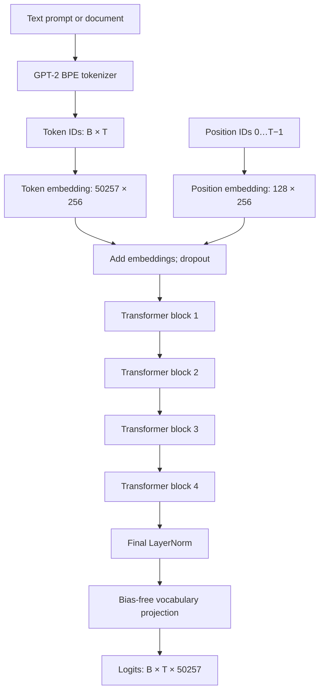
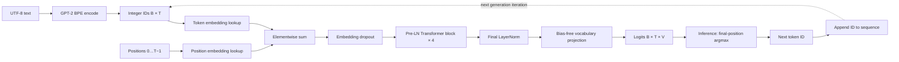
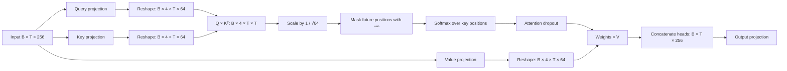
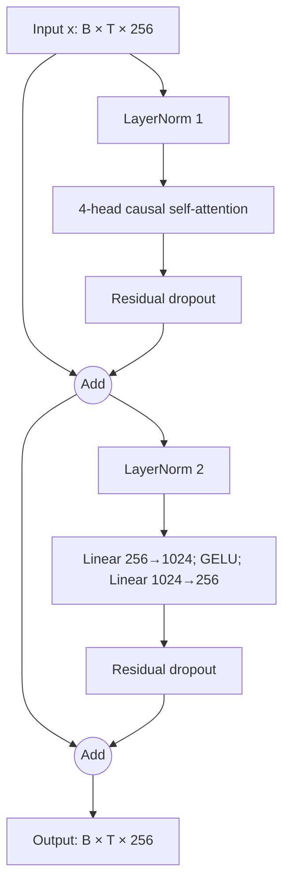
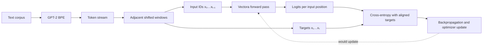
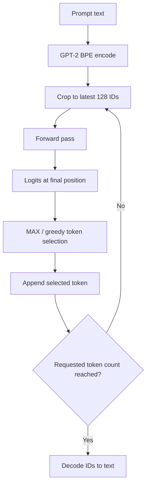

# Vectora v1: Technical Documentation

## Contents

1. [Introduction](#1-introduction)
2. [Architecture Summary](#2-architecture-summary)
3. [System Architecture and Data Flow](#3-system-architecture-and-data-flow)
4. [Tokenization and Vocabulary](#4-tokenization-and-vocabulary)
5. [Token and Positional Embeddings](#5-token-and-positional-embeddings)
6. [Multi-Head Causal Self-Attention](#6-multi-head-causal-self-attention)
7. [Layer Normalization](#7-layer-normalization)
8. [Feed-Forward Network and GELU](#8-feed-forward-network-and-gelu)
9. [Transformer Block](#9-transformer-block)
10. [Complete Model Assembly](#10-complete-model-assembly)
11. [Parameter and Memory Analysis](#11-parameter-and-memory-analysis)
12. [Training Pipeline](#12-training-pipeline)
13. [Inference and Text Generation](#13-inference-and-text-generation)
14. [Fine-Tuning and Adaptation](#14-fine-tuning-and-adaptation)
15. [Evaluation and Results](#15-evaluation-and-results)
16. [Limitations and Current Status](#16-limitations-and-current-status)
17. [Reproducibility and Installation](#17-reproducibility-and-installation)
18. [Future Development](#18-future-development)
19. [References](#19-references)

## 1. Introduction

Vectora v1 is a small decoder-only Transformer implemented in Python and PyTorch in a Jupyter notebook. Its purpose is educational: the README describes a project for exploring tokenization, attention, Transformer layers, and autoregressive prediction by implementing core components rather than calling a hosted language-model API. This is a GPT-style architecture inspired by GPT-2, not a reproduction of GPT-2's released model or training process.

The supplied notebook constructs a model, runs a forward pass on a short slice of a local text file, and performs greedy token generation from a prompt. It explicitly says the weights are randomly initialized and contains no optimization/training loop. Consequently, Vectora v1 as evidenced here is an implementation of a language-model architecture, not a trained language model with demonstrated language competence.

The document separates implemented behavior from the README's project description and from unimplemented training concepts. The README names the repository as `wali321/MY-LLM-s`; the public repository contents could not be independently checked in this documentation run.

## 2. Architecture Summary

The notebook's active configuration is:

| Setting | Notebook value | Role and consequence |
|---|---:|---|
| Vocabulary size `V` | 50,257 | Number of token IDs supported by the GPT-2 encoding and output head. A larger vocabulary increases embedding and output-projection parameters. |
| Context length `T_max` | 128 | Maximum input sequence length accepted by `GPTModel.forward`; self-attention compute and activation storage grow approximately quadratically with sequence length. |
| Model width `d_model` | 256 | Width of token representations and residual stream. Increasing it raises projection and MLP costs roughly quadratically. |
| Attention heads `h` | 4 | Number of parallel attention subspaces. With the configured width, each head has `d_head=256/4=64`. |
| Transformer blocks `L` | 4 | Number of repeated attention-plus-MLP blocks. Increasing depth increases capacity and compute approximately linearly. |
| MLP width | 1,024 | Defined in code as `4 * emb_dim`; controls the per-token nonlinear transformation capacity. |
| Dropout | 0.1 | Applied to token-plus-position embeddings, attention weights, and block branch outputs in training mode. Disabled by `model.eval()`. |
| Q/K/V bias | False | The three attention input projections omit biases. The attention output projection still has its default bias. |
| Tokenizer | `tiktoken.get_encoding("gpt2")` | GPT-2 byte-level BPE encoding. |
| Position encoding | Learned absolute embeddings | Position IDs 0 through `T-1` index an embedding table of size `(128, 256)`. |
| Output weights | Untied | `output_head` is a distinct bias-free linear layer; it is not assigned the token embedding weight. |

A separate 124M-style configuration appears in a Markdown notebook cell, but the active Python configuration below it overwrites that name with the 256-wide, four-layer configuration. It is the latter that the instantiated model uses.

The forward pass maps IDs `(B,T)` to token embeddings, adds learned position vectors, applies dropout, passes the result through four pre-LayerNorm Transformer blocks, applies a final LayerNorm, and projects every position to vocabulary logits `(B,T,V)`.

## 3. System Architecture and Data Flow

### 3.1 Overall architecture



### 3.2 Detailed data-flow diagram


### 3.3 Data flow and shapes

For batch size `B` and sequence length `T≤128`:

| Stage | Shape | Operation |
|---|---|---|
| Encoded input | `(B,T)` | Integer GPT-2 token IDs. |
| Token embeddings | `(B,T,256)` | Lookup in the token table. |
| Position embeddings | `(T,256)` | Lookup at positions `0…T−1`; broadcasts across `B`. |
| Embedding sum | `(B,T,256)` | Token and position vectors added, then embedding dropout. |
| Per-head Q/K/V | `(B,4,T,64)` each | Linear projections and reshape/swap axes. |
| Attention scores | `(B,4,T,T)` | Query-key dot products, then causal masking and scaling. |
| Block output | `(B,T,256)` | Attention and MLP residual branches preserve width. |
| Final logits | `(B,T,50257)` | One vocabulary score vector per input position. |

Here `B` is batch size, `T` is sequence length, `V=50,257`, `d_model=256`, `h=4`, and `d_head=d_model/h=64`.

### 3.3 Autoregressive loop

At inference, the notebook uses the logits at the final input position to select one next token, appends that ID to the sequence, truncates the model input to its most recent 128 IDs on the next iteration, and repeats. This feedback loop conditions each subsequent prediction on the original prompt and all generated tokens still inside the context window.

## 4. Tokenization and Vocabulary

The notebook obtains an encoding with `tiktoken.get_encoding("gpt2")` and calls `encode` and `decode`. GPT-2 BPE represents text as a sequence of subword/byte-level units rather than whitespace-separated words. This allows a fixed vocabulary to represent many strings, while the token count depends on spelling, punctuation, and language. Therefore 128 tokens do not correspond to a fixed number of words or characters.

The GPT-2 encoding includes the special end-of-text token `<|endoftext|>` (ID 50256). The notebook does not explicitly insert it into training examples, test for it during generation, or configure special-token handling in the shown encode call. The output dimension 50,257 reflects IDs 0 through 50,256.

The model accepts token IDs only; callers must use a tokenizer whose IDs match this vocabulary. Inputs longer than the configured context length raise `ValueError`. Generation itself crops model inputs to the latest `context_size` tokens before each forward pass. The input text is sliced to its first 10,000 characters in the notebook's demonstration; this is a demonstration choice, not a model limit.

## 5. Token and Positional Embeddings

An embedding table maps a discrete token index to a learned vector. Let `E∈R^(V×d_model)` denote the token table and `P∈R^(T_max×d_model)` the position table. For token ID `x_t` at position `t`, the notebook computes

\[
h_t^{(0)} = E[x_t] + P[t].
\]

For a batch, `E[x]` has shape `(B,T,256)` and the position lookup has shape `(T,256)`, which broadcasts over the batch. Position information is needed because self-attention by itself does not encode token order. These absolute position vectors are learned parameters, not sinusoidal functions or rotary embeddings.

The token table contains `50,257×256 = 12,865,792` parameters; the position table contains `128×256 = 32,768`. The notebook's output matrix is a separate table-like projection (see §11); weights are not tied.

## 6. Multi-Head Causal Self-Attention

For each sequence position, separate learned linear layers produce query, key, and value vectors. With `X∈R^(B×T×256)`, each projection maps width 256 to width 256. The result is reshaped into four heads of width 64 and transposed to `(B,4,T,64)`.

For a head, the scaled causal attention operation is

\[
\operatorname{Attention}(Q,K,V)=\operatorname{softmax}\left(\frac{QK^\top}{\sqrt{d_k}}+M\right)V.
\]

`Q`, `K`, and `V` are query, key, and value tensors; `d_k=64` is the per-head key width; `M` is an additive causal mask with zero for allowed key positions and negative infinity for future positions. The softmax is over the last, key-position dimension. The scale `1/√d_k` (implemented by dividing scores by `sqrt(head_dim)`) controls the magnitude of dot products as the feature width grows, helping avoid overly peaked softmax distributions. The mask ensures position `t` cannot use information from positions greater than `t`.

In code, `QKᵀ` has shape `(B,4,T,T)`. A registered upper-triangular boolean mask is sliced to `T×T`; future scores are replaced with `-inf`. Softmax weights are then passed through dropout, multiplied by `V`, and the four head outputs are concatenated to `(B,T,256)`. A final learned output projection maps 256 to 256 and includes a bias.

The attention layer's Q/K/V matrices have shape `(256,256)` each with no bias. Its output projection has a `(256,256)` weight and 256-element bias. No key/value cache or fused attention kernel is shown. The full `(T,T)` attention-score tensor is materialized by the notebook implementation.


### Attention operation diagram


## 7. Layer Normalization

`LayerNorm` computes mean and variance over the final (embedding) dimension independently for each batch item and position. For vector `x∈R^256`,

\[
\mu=\frac{1}{256}\sum_{i=1}^{256}x_i,\quad
\sigma^2=\frac{1}{256}\sum_{i=1}^{256}(x_i-\mu)^2,
\]

\[
\operatorname{LN}(x)=\gamma\odot\frac{x-\mu}{\sqrt{\sigma^2+\epsilon}}+\beta.
\]

`γ` and `β` are learned 256-element scale and shift vectors, `ε=10^{-5}` is the numerical-stability constant, and `⊙` is elementwise multiplication. The notebook uses `torch.var(..., unbiased=False)`, matching the population-variance divisor shown above.

Each block normalizes before attention and before the MLP (pre-LayerNorm). A final normalization follows all four blocks. Each LayerNorm contributes 512 trainable values.

## 8. Feed-Forward Network and GELU

At each sequence position independently, the feed-forward network expands the vector from 256 to 1,024, applies the notebook's tanh-approximation to GELU, and projects back to 256:

\[
\operatorname{FFN}(x)=W_2\,\operatorname{GELU}(W_1x+b_1)+b_2,
\]

where `W₁∈R^(1024×256)`, `b₁∈R^1024`, `W₂∈R^(256×1024)`, and `b₂∈R^256`. The positionwise operation is shared across all positions; information across positions is mixed by attention, not by this MLP.

The implementation approximates GELU as

\[
\operatorname{GELU}(x)\approx\frac{x}{2}\left[1+\tanh\left(\sqrt{2/\pi}(x+0.044715x^3)\right)\right].
\]

The two `nn.Linear` layers include biases. They contribute `256×1024+1024 + 1024×256+256 = 525,568` parameters per block.

## 9. Transformer Block

Each block is pre-LayerNorm with two residual additions:



In symbols, `u=x+Dropout(Attention(LN₁(x)))`, then `y=u+Dropout(FFN(LN₂(u)))`. The residual paths preserve the input representation and permit gradients to flow around each transformation. The same configured dropout rate (0.1) is used for attention probabilities and the residual branches; embedding dropout is applied before the first block. PyTorch dropout is active in training mode and disabled in evaluation mode.

## 10. Complete Model Assembly

`GPTModel.forward(token_ids)` first unpacks `(B,T)` and rejects `T>128`. It looks up token and absolute position embeddings, adds them, applies embedding dropout, executes four blocks in sequence, applies final LayerNorm, and applies a bias-free linear output head. The result is unnormalized vocabulary logits; softmax is not part of `forward`.

A complete shape trace is:

```text
(B,T) IDs
→ (B,T,256) token embeddings + broadcast position embeddings
→ (B,T,256) embedding dropout
→ (B,T,256) × 4 Transformer blocks
→ (B,T,256) final LayerNorm
→ (B,T,50257) logits
```

Within each block: Q/K/V are `(B,4,T,64)`, scores and attention weights are `(B,4,T,T)`, head contexts are combined to `(B,T,256)`. The active demonstration uses `B=1`, `T=128` for the model shape check (the text is encoded from a 10,000-character prefix and only its first 128 IDs are placed in the input tensor).

## 11. Parameter and Memory Analysis

The following count is derived from the active notebook configuration and the exact layer definitions. Linear-layer bias settings are included explicitly.

| Component | Calculation | Parameters |
|---|---:|---:|
| Token embedding | `50,257×256` | 12,865,792 |
| Position embedding | `128×256` | 32,768 |
| Q/K/V per block | `3×(256×256)`; no biases | 196,608 |
| Attention output projection per block | `256×256+256` | 65,792 |
| Feed-forward per block | `256×1024+1024+1024×256+256` | 525,568 |
| Two block LayerNorms | `2×(256 scale+256 shift)` | 1,024 |
| All four Transformer blocks | `4×(196,608+65,792+525,568+1,024)` | 3,155,968 |
| Final LayerNorm | `256+256` | 512 |
| Untied output head | `256×50,257`, no bias | 12,865,792 |
| **Total** | Sum of above | **28,920,832** |

This is not a tied-weight count. If the output head shared the token embedding matrix, its weight would not be counted twice, reducing the count by 12,865,792 to 16,055,040. The supplied code does not tie these weights, so the applicable total is 28,920,832. A model-side count helper in the notebook sums `model.parameters()` at runtime; no printed count output was included in the supplied notebook.

At FP32, the parameter tensors alone occupy `28,920,832×4 = 115,683,328` bytes, approximately 110.3 MiB (binary MiB). This excludes allocator overhead and non-parameter buffers such as the causal mask. During training, weights plus gradients would be about 220.6 MiB in FP32. As an illustrative assumption only, standard Adam with two FP32 moment tensors adds about 220.6 MiB, bringing those three categories to roughly 441.2 MiB, before activations, temporary tensors, and framework overhead. The notebook does not instantiate an optimizer or perform training, so this is not an observed memory measurement.

At sequence length `T`, attention-score storage scales as `B×h×T²`; at `B=1,T=128,h=4`, that is 65,536 score elements per layer (not counting softmax, dropout, and value/context intermediates). Training activation memory depends on the batch size, sequence length, implementation, and autograd retention; no measured peak is available.

## 12. Training Pipeline

No training pipeline is implemented in the supplied notebook. There is no dataset loader or preprocessing pipeline, sliding-window/input-target batching, optimizer, loss calculation, backward pass, scheduler, gradient clipping, weight decay configuration, checkpoint save/load, or training-step loop. The notebook reads `wizardofoz.txt`, encodes a prefix, and sends one input batch through the model; that is a forward-pass demonstration, not training.

For context, a conventional causal language-model training objective would shift the input sequence by one token. If the source sequence is `(x₀,…,xₜ)`, model inputs are `(x₀,…,xₜ₋₁)` and target IDs are `(x₁,…,xₜ)`. For logits `z_{b,t,v}`, the cross-entropy objective is

\[
\mathcal{L}=-\frac{1}{BT}\sum_{b=1}^{B}\sum_{t=1}^{T}\log\frac{\exp(z_{b,t,y_{b,t}})}{\sum_{v=1}^{V}\exp(z_{b,t,v})},
\]

where `y_{b,t}` is the next-token target at position `t`. This equation describes a standard possible objective; the notebook does not compute it. The data file name suggests a text source, but its contents, license, provenance, and actual use for training cannot be verified from the supplied materials.


Training data/target flow (conceptual only; absent from the notebook):


## 13. Inference and Text Generation



The implemented generation method is greedy decoding:

1. Call `model.eval()`.
2. Take the last `context_size` token IDs as model input.
3. Run the forward pass under `torch.no_grad()`.
4. Select logits at the final sequence position.
5. Choose `argmax` across the vocabulary and append that ID.
6. Repeat for `max_new_tokens` iterations.

Equivalent pseudocode:

```python
for _ in range(max_new_tokens):
    model_input = token_ids[:, -context_size:]
    with torch.no_grad():
        logits = model(model_input)
    next_id = logits[:, -1, :].argmax(dim=-1, keepdim=True)
    token_ids = torch.cat((token_ids, next_id), dim=1)
```

Temperature, top-k, top-p, beam search, sampling, and an explicit end-of-text stopping condition are not implemented in the shown generation function. The function always emits the requested number of tokens. Context truncation is implemented by the slice; the model itself raises an error if passed more than 128 tokens. The notebook demonstration requests five new tokens. Because the weights are initialized but not trained, the generated sequence is not evidence of meaningful language modeling.

## 14. Fine-Tuning and Adaptation

No classification fine-tuning, instruction fine-tuning, padding/target masking, LoRA, or other parameter-efficient adaptation method is implemented in the supplied notebook. There is also no general training routine to adapt the model. These methods are outside the verified current capability.

## 15. Evaluation and Results

No training or validation loss, perplexity, benchmark score, evaluation dataset, baseline comparison, or result graph is supplied. The code prints tensor shapes and has a helper that can report parameter count and parameter storage, but captured output is absent. It also prints a sample generated string, but no such output was included in the provided notebook content. No performance or quality claims can be substantiated.

Perplexity would be `exp(mean token-level cross-entropy)` for a valid held-out evaluation loss, but there is no verified loss measurement from which to calculate it.

## 16. Limitations and Current Status

Verified from the supplied notebook: four decoder blocks, 256-dimensional representations, four causal attention heads, learned positions up to 128 tokens, GPT-2 token IDs, PyTorch modules, and greedy generation. The notebook imports `torch_directml` and selects `torch_directml.device()`, indicating an intended DirectML execution path; actual GPU availability, hardware, compatibility, and successful execution are not established by source code alone.

The README states that weights are currently randomly initialized, consistent with the notebook constructing a new `GPTModel` without loading a checkpoint or pretrained weights. A correct forward pass and text decoding demonstrate that tensor plumbing works; they do not establish that the model has learned language. No checkpoints or saved weights were supplied for inspection. Training status, dataset properties, optimizer settings, and evaluation evidence are missing.

## 17. Reproducibility and Installation

The README suggests installing PyTorch, `tiktoken`, and Jupyter, and mentions DirectML for AMD GPU experiments on Windows. The notebook additionally imports `torch_directml`, so that package must be available to execute the notebook exactly as supplied. No pinned package versions or lock file were provided.

The README instructs users to open `MYLLM.ipynb`, while the supplied notebook is named `v1.ipynb`; treat this as a documentation/file-name mismatch. The notebook also expects a local `wizardofoz.txt` in the working directory. That file was not supplied here, so the notebook's initial data-reading cell will fail unless the file is provided or that cell is changed.

A minimal model-construction example matching the notebook's classes and configuration is:

```python
import torch
import torch_directml
import tiktoken

# Define LayerNorm, GELU, FeedForward, MultiHeadAttention,
# TransformerBlock, and GPTModel as in v1.ipynb first.
config = {
    "vocab_size": 50257,
    "context_length": 128,
    "emb_dim": 256,
    "n_heads": 4,
    "n_layers": 4,
    "drop_rate": 0.1,
    "qkv_bias": False,
}

device = torch_directml.device()
tokenizer = tiktoken.get_encoding("gpt2")
model = GPTModel(config).to(device)
model.eval()

ids = torch.tensor(
    [tokenizer.encode("A short prompt")],
    dtype=torch.long,
    device=device,
)
with torch.no_grad():
    logits = model(ids)
print(tuple(logits.shape))  # (1, prompt_token_count, 50257)
```

This creates a fresh randomly initialized model. To use CPU instead, replace the DirectML device with `torch.device("cpu")` and ensure the `torch_directml` import is removed. Checkpoint loading is not shown or verified. For the notebook's file-reading cell, run Jupyter from a directory containing `wizardofoz.txt`, or update the path to the actual data location.

## 18. Future Development

The following are possible next steps, not existing features: add a documented dataset and provenance; implement reproducible input-target batching and causal loss; record optimizer, schedule, training steps, checkpoints, and validation metrics; add an evaluation protocol; test DirectML and CPU paths on named environments; implement temperature/top-k/top-p sampling and end-of-text handling; add checkpoint save/load; investigate weight tying, longer context, activation/memory optimizations, and parameter-efficient fine-tuning. Any resulting capability should be documented only after it is implemented and measured.

## 19. References

### Foundational references

1. Vaswani, A. et al. (2017). “Attention Is All You Need.” *Advances in Neural Information Processing Systems 30*. [Proceedings page](https://papers.nips.cc/paper_files/paper/2017/hash/3f5ee243547dee91fbd053c1c4a845aa-Abstract.html). Foundational Transformer and scaled dot-product attention reference.
2. Radford, A. et al. (2019). “Language Models are Unsupervised Multitask Learners.” OpenAI. [Technical report](https://d4mucfpksywv.cloudfront.net/better-language-models/language-models.pdf) and [OpenAI overview](https://openai.com/index/better-language-models/). Relevant background for GPT-2; Vectora v1 is not a reproduction of GPT-2.
3. Ba, J. L., Kiros, J. R., and Hinton, G. E. (2016). “Layer Normalization.” [arXiv:1607.06450](https://arxiv.org/abs/1607.06450).
4. Hendrycks, D. and Gimpel, K. (2016). “Gaussian Error Linear Units (GELUs).” [arXiv:1606.08415](https://arxiv.org/abs/1606.08415).

### Implementation resources

5. PyTorch. [Official documentation](https://pytorch.org/docs/stable/index.html). The notebook uses `torch`, `torch.nn`, tensor operations, and dropout/linear/embedding modules.
6. OpenAI. [`tiktoken` repository and usage notes](https://github.com/openai/tiktoken). The notebook uses `tiktoken.get_encoding("gpt2")`.
7. Raschka, S. *Build a Large Language Model (From Scratch).* [Book site](https://sebastianraschka.com/books.html). The README identifies this book as a learning resource. The exact edition or passages used were not documented.

The references above provide background and package documentation. Apart from the README's explicit mention of Raschka's book and the code imports/API calls, the supplied files do not record a formal citation trail or establish that a particular source was directly followed for each implementation choice. LoRA is not referenced because it is not implemented.

